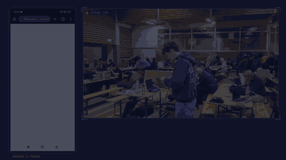

# BackTogether

**A drone finds the lost child. A robot stays with them until their family arrives.**



*The demo, at 3× speed: the parent sends a photo, the drone finds Jorge, the robot drives to him,
greets him by name and opens the video call with his parent.*

Leukerbad Robotics Hackathon 2026, track *Resilient & Safe City*. Built in three days and shown
live with the real robots: a **HoverAir X1** drone and a **Bobac3** wheeled ROS robot with a
screen, a head camera and two lidars.

> This repository is a snapshot of the code we demoed, published for the jury. The robot
> vendor's code and manuals are not included, and every address, topic and password is a
> placeholder (see [Placeholders](#placeholders)): it documents the system, it does not run as is.

## What it does
1. **A parent opens the web page** on their phone and sends the child's name and a few photos.
   No app, no account.
2. **The photos reach the drone laptop and the robot by themselves.** Both listen to the page's
   topic and save the photos in a folder named after the child.
3. **The drone searches.** It takes off from the floor in front of the robot, flies a lawnmower
   sweep at 2.5 m and recognises *that* child in its live video, by face.
4. **It sends the child's position to the robot** as soon as it is over them, as metres ahead
   and to the left of where the robot stood at takeoff. It stays over the child while the robot
   drives there.
5. **The robot drives there** with SLAM and obstacle avoidance. If the child is not in view, it
   turns on the spot, then drives wider circles around the goal until it recognises their face.
6. **The robot looks after the child.** A voice agent greets them by the name the parent sent
   and keeps them calm and in place. The parents get a push notification, and a video call with
   them opens on the robot's screen.
7. **The drone lands back on the robot**, ready for the next search.

```
parent's phone ── web page ──► ntfy topic ──┬─► drone laptop: photos ─► drone search ─┐
                                            └─► robot: photos for face recognition    │
                                                                                      │ child's x, y
robot ◄── ngrok ◄─────────────────────────────────────────────────────────────────────┘
  └─ drives there ─► finds the face ─► voice agent + video call + notification to the parents
```

## What is in the repo
| Folder | What |
|---|---|
| [web/](web/) | the parents' page (BackTogether, a phone-first PWA on GitHub Pages): name + photos, sent to an [ntfy](https://ntfy.sh) topic |
| [scripts/web_inbox.py](scripts/web_inbox.py) | the receiver for the page's requests, on the robot and on the drone laptop: saves each child's photos in `<name>/` (standard library, Python 3.8+) |
| [drone/hoverctl/](drone/hoverctl/), [drone/proto/](drone/proto/) | our own link to the HoverAir X1, **reverse-engineered from its app**: BLE commands and telemetry, Wi-Fi RPC, UDP sticks, RTP/H.264 video ([drone/README.md](drone/README.md)) |
| [drone/sdk/](drone/sdk/) | a Python SDK on top of it: telemetry and video, pose estimate, navigation with safety rules (geofence, altitude, battery, link loss), missions, recording, simulator, HTTP API ([API.md](drone/sdk/API.md)) |
| [drone/identify/](drone/identify/) | recognising the child in the drone video: YuNet + SFace faces and YOLOX people (OpenCV Zoo, CPU, offline), plus small models we trained for the robot and its landing pad |
| [drone/patrol/](drone/patrol/) | the search patterns: lawnmower sweep, bounce patrol, monocular front distance |
| [drone/find_child.py](drone/find_child.py), [drone/dock_robot.py](drone/dock_robot.py), [drone/report_child.py](drone/report_child.py) | the mission: find the child, send them to the robot, land on the robot |
| [bobac/…/src/bringup/](bobac/vendor/bobac3_ws/src/bringup/) | our ROS package for the robot: the demo launch, the state machine (`home → arrived → searching → care`), `child_goal_server` (the drone's report becomes a navigation goal), the face search around the goal, the face on the screen |
| [bobac/…/src/kid_care/](bobac/vendor/bobac3_ws/src/kid_care/) | our ROS package for the care flow: Gemini Live voice agent, Jitsi video call on the screen, ntfy notification to the parents |
| [docs/PITCH.md](docs/PITCH.md) | the pitch notes: problem, use cases, what we built |

The robot's own ROS packages (base, lidars, navigation, `face_rec`) come installed on the Bobac3
in `~/bobac3_ws` and are not in this repo. Our two packages build on top of them.

## Placeholders
Every real address, topic and password was replaced by a placeholder in all files and in the
whole history. To run the system, put your own values back in the places listed here.

| Placeholder | What it is | Where it is used |
|---|---|---|
| `<NTFY_TOPIC>` | the [ntfy](https://ntfy.sh) topic the page posts requests to, and the topic the parents are notified on. Pick a long random name: anyone who knows it can post to it | `web/config.js` (`apiUrl`), which `scripts/web_inbox.py` also reads; `NTFY_TOPIC` in the robot's `kid_care/.env` |
| `<ROBOT_NGROK_DOMAIN>` | the robot's public [ngrok](https://ngrok.com) domain, the drone laptop's way to reach the robot over the internet | `ROBOT_URL` in `drone/report_child.py`; the robot runs `bringup/systemd/ngrok.service` |
| `<DRONE_WIFI_PASSWORD>` | the password our code gives the drone's Wi-Fi on every Bluetooth connect (any 8+ characters) | `DEFAULT_WIFI_PASSWORD` in `drone/hoverctl/ble.py`, `drone/patrol/winfly` |
| `<DRONE_IP>`, `<DRONE_SUBNET>` | the drone's fixed address on its own Wi-Fi, and that network | `drone/hoverctl/`, `drone/sdk/`, `drone/README.md` |
| `<DRONE_LAPTOP_IP>` | the drone laptop's address on the drone's Wi-Fi | `drone/sdk/client.py` (example) |
| `<ROBOT_IP>` | the robot's address on the local network, for SSH and for a direct link | `drone/robot_watch`, `drone/report_child.py` examples, this README |
| `<LAPTOP_A_IP>`, `<LAPTOP_B_IP>`, `<ETHERNET_SUBNET>` | the two laptops of the optional Ethernet link | [Other links](#other-links) |

A few older commits also have `<SERVER_IP>`, an example address in a comment.

Kept out of the repo entirely, never committed: the Gemini API key and the other values in the
robot's `kid_care/.env`, the photos of people, and the trained models.

## Running it
You need the drone, the Bobac3 robot, a laptop to fly the drone (we used a Mac) and
[uv](https://docs.astral.sh/uv/). First fill in the [placeholders](#placeholders).

### 1. The web page
```bash
cd web && python3 -m http.server 8080     # locally, on http://localhost:8080
```
Pushing to `main` deploys it to GitHub Pages ([.github/workflows/pages.yml](.github/workflows/pages.yml)),
once Settings → Pages → Source is set to **GitHub Actions**. With `apiUrl: ""` in
`web/config.js` the page runs in demo mode and sends nothing. Details: [web/README.md](web/README.md).

### 2. The robot (ROS Noetic, Python 3.8)
Once:
- put this repo on the robot and build our two packages:
  ```bash
  cd bobac/vendor/bobac3_ws && catkin build bringup kid_care --no-deps && source devel/setup.bash
  ```
- create `bobac/vendor/bobac3_ws/src/kid_care/.env` (git ignores it) with these values
  ([kid_care/README.md](bobac/vendor/bobac3_ws/src/kid_care/README.md)):
  ```
  GEMINI_API_KEY=<your key from Google AI Studio>
  NTFY_TOPIC='<NTFY_TOPIC>'
  VOICE_AGENT_PYTHON=<a Python 3.11 venv with google-genai>/bin/python
  ```
- install the two user services in `bringup/systemd/`: `web-inbox.service` saves the page's
  photos in `~/.reinovo/face_data/<name>/`, where face recognition reads them, and
  `ngrok.service` keeps the ngrok link to `child_goal_server` up. The install steps are at the
  top of each file.

Every demo, **after** the parent has sent the photos (face recognition loads them when it starts):
```bash
roslaunch bringup state_demo.launch person:=<child's name>
```
To test the robot without the drone, send it a child 1.8 m ahead of it:
```bash
curl -X POST localhost:8001/child_found -H 'Content-Type: application/json' \
     -d '{"mission_id": "test", "x": 1.8, "y": 0, "frame": "robot"}'
```
More in [bringup/README.md](bobac/vendor/bobac3_ws/src/bringup/README.md). The robot must stand
still between the drone's takeoff and the drone's report.

### 3. The drone laptop
Once:
```bash
uv sync
uv run --with opencv-contrib-python-headless python -m drone.identify.models   # 75 MB of models
```
Then train the landing pad and robot models with your own photos
([drone/identify/README.md](drone/identify/README.md)).

Every demo, with the laptop on the drone's Wi-Fi and internet from a second link (we used an
iPhone on USB, see [Other links](#other-links)):
```bash
drone/fly          # the drone link and its web page on http://127.0.0.1:8077/; leave it running
drone/robot        # is the robot reachable through ngrok and ready?
drone/demo         # waits for the parent's request, searches, sends the child, lands on the robot
```
Windows has the same commands as `.cmd` files. The smaller pieces:
- `drone/inbox` only saves the page's photos;
- `drone/find <name>` runs only the search;
- `drone/watch <name>` recognises the child while you fly by hand;
- `drone/robot X Y` sends the robot a child by hand;
- `drone/dock` only lands on the robot.

## Other links
**Mac on the drone's Wi-Fi + iPhone over USB** (what we used). The Mac flies the drone on its
Wi-Fi and gets internet from an iPhone on a USB cable (Personal Hotspot): one network per
interface. In System Settings → Network → Set Service Order, put **iPhone USB above Wi-Fi**.
Then `route -n get default` must show the iPhone and `route -n get <DRONE_IP>` the Wi-Fi. The
child's position reaches the robot through ngrok. An Android phone over USB does not work on
macOS (RNDIS).

**Ethernet between two laptops**, without a phone. Laptop A flies the drone; laptop B is on the
event Wi-Fi and forwards port 8001 to the robot over SSH. The cable joins the two laptops, never
the robot, which drives away:
```
drone ── drone Wi-Fi ── LAPTOP A (<LAPTOP_A_IP>) ══ Ethernet ══ LAPTOP B (<LAPTOP_B_IP>) ── event Wi-Fi ── robot :8001
```
- **Both laptops:** fixed IPs on the cable with no gateway.
- **Laptop B:** `ssh -N -L <LAPTOP_B_IP>:8001:127.0.0.1:8001 <user>@<ROBOT_IP>`.
- **Laptop A:**
  ```bash
  python3 -m drone.report_child --to http://<LAPTOP_B_IP>:8001 --watch
  ```

## How we worked
Six people, each with a coding agent, in parallel on one repo. The rules every person and agent
followed are in [AGENTS.md](AGENTS.md) and [COMMITS.md](COMMITS.md): one task per GitHub issue,
one branch and PR per task, Conventional Commits checked by a hook and by CI
([.github/workflows/ci.yml](.github/workflows/ci.yml)).
```bash
uv sync && uv run ruff check .                    # Python 3.11, lint
python3 scripts/check_web.py                       # the web page's files
```

**Team:**
- Guillermo Ruiz de Azúa (`gra1111`): robot behaviour, care flow, integration;
- Rodrigo Sagastegui (`rorosaga`) and Andrés Gil Vicente (`andresgilvicente`): drone;
- Liam Esgueva (`liiiaamm`): robot navigation and face following, drone recognition;
- Jorge Carnicero (`jorgecarnicero`): web page and robot bringup;
- `GRINGOLOCO7`: robot bringup, the drone's goal and the face search.
